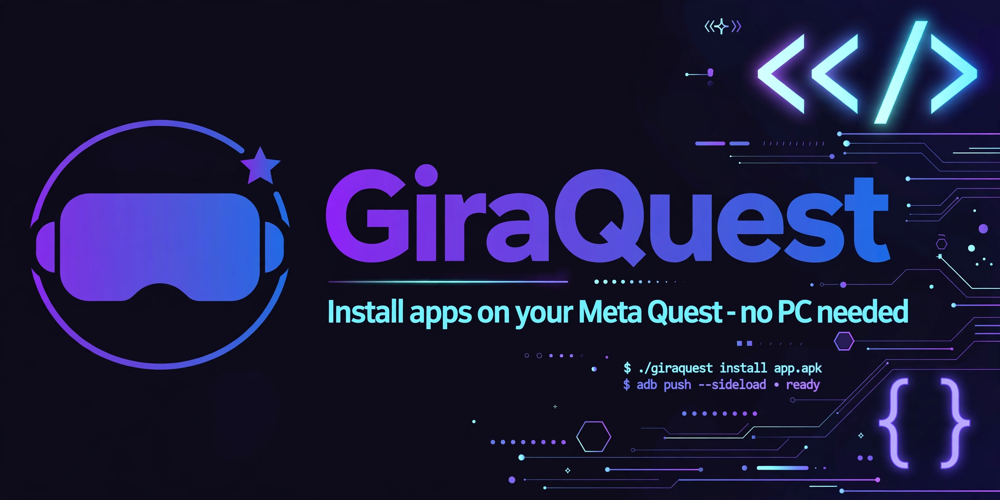

# GiraQuest

**Install apps on your Meta Quest 2 and 3 — no PC needed.**

## Trailer

GiraQuest is a free, all-in-one installer and file manager for Meta Quest headsets. Install APK files, place OBB/data folders and manage your files, all on the headset. No PC, no cables, no ADB.

## What it does

- Install APKs directly on your Quest (with a confirmation dialog)
- Automatic OBB/data folder placement for games that need it
- Built-in file explorer: browse, copy, move and delete files
- Download manager with progress and resume
- Installed apps list with uninstall
- Update detection: get notified when a newer version of an installed app is available
- Optional: add your own repositories to browse and install from them

## Requirements

- Meta Quest 2 or 3 with Developer Mode enabled
- No PC required

## Install

1. Download the latest APK from the [Releases](https://github.com/GiraQuest/GiraQuest/releases) page
2. Install it on your Quest
3. Open GiraQuest and grant the permissions it asks for on first run

## Free

GiraQuest is free. No payments, no ads, no account.

## Language

The app interface is available in 20 languages: English, Spanish, Arabic, German, French, Hindi, Indonesian, Italian, Japanese, Korean, Dutch, Polish, Portuguese, Russian, Thai, Turkish, Ukrainian, Vietnamese, Chinese (Simplified) and Chinese (Traditional). Pick yours in Settings, or follow the system language.

## Feedback

Found a bug or have an idea? Open an Issue: https://github.com/GiraQuest/GiraQuest/issues

## Disclaimer

GiraQuest is a generic installation tool. It ships empty: no games, no content, no repositories included. Any repository you add is configured by you and your responsibility. Only use content and sources you have the right to use, and respect copyright law in your country.

